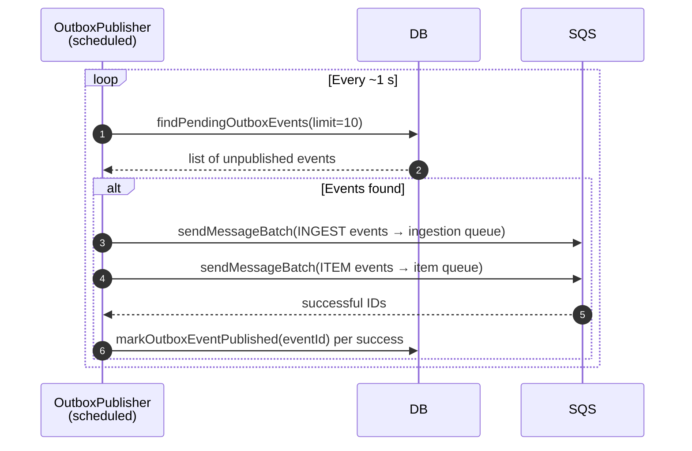
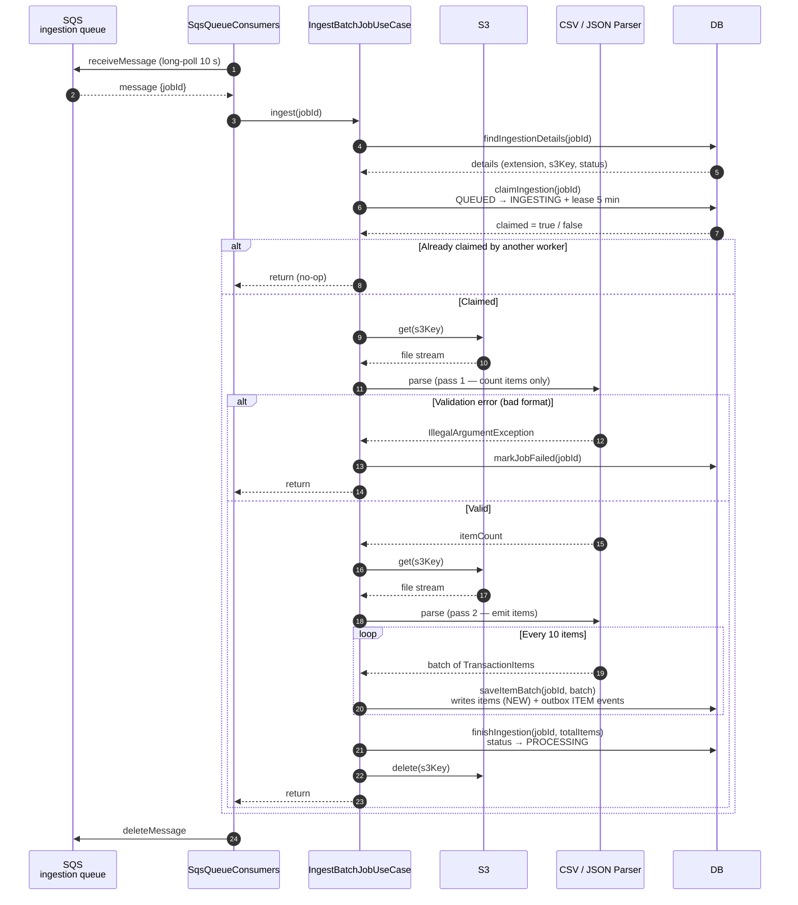
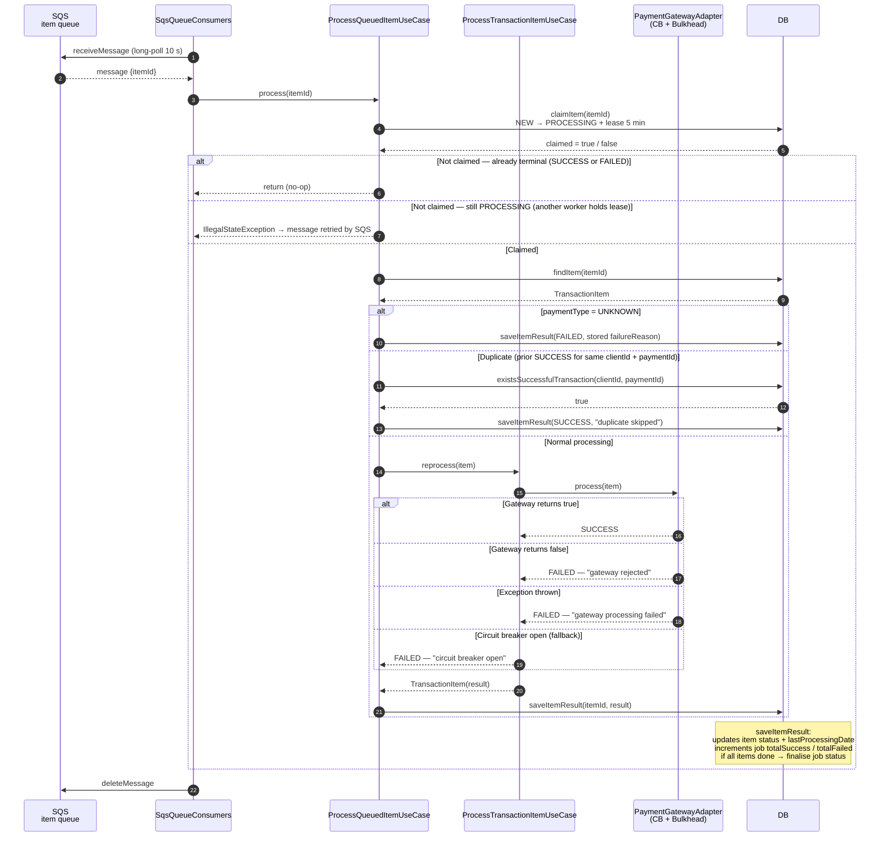
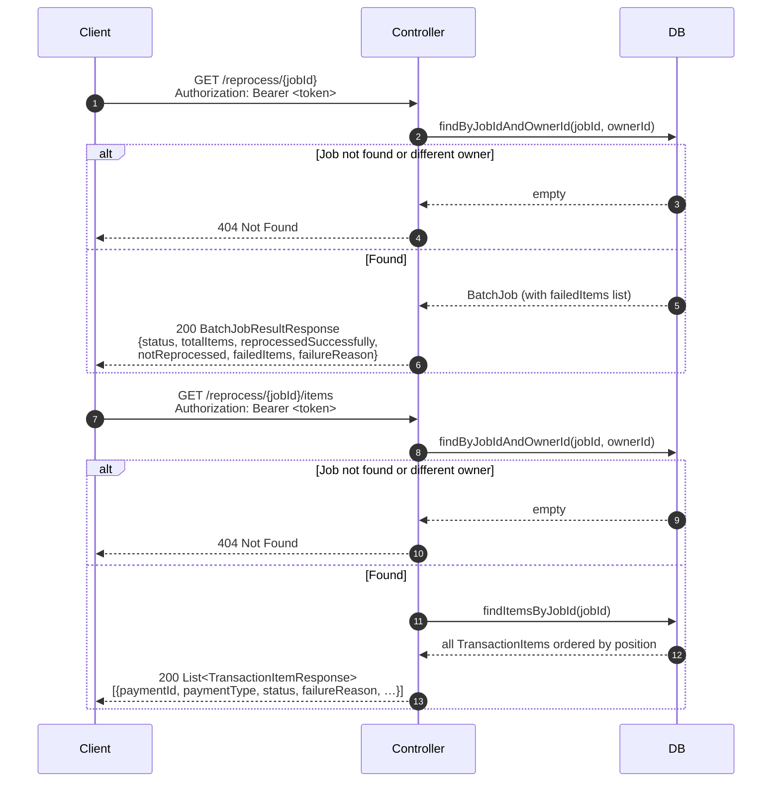
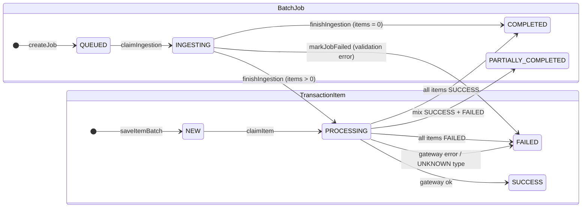

# Architecture

## Overview

The API accepts a CSV or JSON file, stores it in S3, and returns a job reference immediately
(`202 Accepted`). A background pipeline then ingests the file and processes each payment item
independently. Clients poll two read endpoints to track progress.

The pipeline has three asynchronous stages connected by the Transactional Outbox pattern and SQS:

```
  POST /reprocess          Outbox → SQS          SQS → Worker
 ┌──────────────┐        ┌───────────────┐      ┌─────────────────────┐
 │  1. Upload   │──────► │  2. Ingest    │────► │  3. Process items   │
 │   (sync)     │        │   (async)     │      │      (async)        │
 └──────────────┘        └───────────────┘      └─────────────────────┘
  returns jobId           reads S3, writes        one message per item,
  in < 1s                 items to DB             calls payment gateway
```

---

## Module map

```
src/main/java/com/virgolim/paymentapi/
│
├── domain/
│   ├── model/          BatchJob, TransactionItem, PaymentType, ProcessingStatus
│   └── exception/      BusinessException, ResourceNotFoundException
│
├── usecase/
│   ├── UploadBatchFileUseCase        (sync, called by controller)
│   ├── IngestBatchJobUseCase         (async, called by SQS consumer)
│   ├── ProcessQueuedItemUseCase      (async, called by SQS consumer)
│   └── ProcessTransactionItemUseCase (called by ProcessQueuedItemUseCase)
│
└── infra/
    ├── web/            REST endpoints + DTOs
    ├── security/       JWT filter + SecurityConfig
    ├── extraction/     CSV and JSON streaming parsers
    ├── storage/        S3-compatible object storage
    ├── queue/          SqsQueueConsumers (polling) + OutboxPublisher (scheduled)
    ├── payment/        PaymentGatewayFactory + gateway adapters
    ├── persistence/
    │   ├── BatchJobRepository          (domain port / interface)
    │   ├── adapter/                    PostgreSQL implementation
    │   └── dynamodb/                   DynamoDB implementation  ← default profile
    └── config/         AwsClientConfig, SecurityConfig, PaymentCloudProperties
```

---

## Security

Every `/api/v1/payments/**` request must carry a Bearer JWT with the `PAYMENT_OPERATOR` role.
The filter runs before Spring Security's authentication filter.

```
Client ──► JwtAuthenticationFilter ──► Spring Security (role check) ──► Controller
              extracts sub as ownerId       hasRole(PAYMENT_OPERATOR)
```

The `sub` claim becomes the `ownerId` that scopes all DB reads — a user can only see their own jobs.
Actuator health endpoints are public. All other paths require authentication.

---

## Flow 1 — Upload (synchronous)

`POST /api/v1/payments/reprocess`


**What is written:** S3 object + `batch_job` row (status `QUEUED`) + `outbox_event` row (type `INGEST`).  
**Error handling:** empty file or missing extension → `BusinessException` → 400. Race condition on unique key → S3 orphan deleted, idempotent retry.

---

## Flow 2 — Outbox to SQS (scheduled)

`OutboxPublisher` runs every ~1 s and bridges the local DB with SQS.



**Why it exists:** writing the outbox row in the same DB transaction as the job/item data means no
message is lost if the process crashes between DB commit and SQS send. Failed SQS sends are retried
on the next poll cycle (at-least-once delivery).

---

## Flow 3 — Ingestion (asynchronous)

`SqsQueueConsumers.pollIngestionQueue` → `IngestBatchJobUseCase`



**What is written per item:** `transaction_item` row (status `NEW`, with `failureReason` pre-filled for `UNKNOWN` types) + `outbox_event` row (type `ITEM`).  
**Unknown payment types (e.g. PIX):** accepted without error. The item is stored with `paymentType = UNKNOWN` and a `failureReason` set at parse time. The gateway is never called for these items.

---

## Flow 4 — Item processing (asynchronous)

`SqsQueueConsumers.pollItemQueue` → `ProcessQueuedItemUseCase` → `ProcessTransactionItemUseCase`



**Job finalisation rule (inside `saveItemResult`):**

```
if ingestionComplete AND totalSuccess + totalFailed >= totalItems:
    totalFailed  = 0            → COMPLETED
    totalSuccess = 0            → FAILED
    both > 0                    → PARTIALLY_COMPLETED
```

---

## Flow 5 — Reading results (synchronous)



---

## Job and item lifecycle



---

## Persistence and profiles

`BatchJobRepository` is the single persistence port. Two implementations are provided:

| Profile | Implementation | Tables / collections |
|---|---|---|
| `dynamodb` (default) | `DynamoBatchJobRepository` | `payment-api-batch-jobs`, `payment-api-transaction-items`, `payment-api-outbox-events` |
| `postgresql` | `BatchJobRepositoryAdapter` (JPA) | `batch_jobs`, `transaction_items`, `outbox_events` |

The DynamoDB adapter uses three GSIs: `IdempotencyKeyIndex` (idempotency lookup), `BatchJobIndex`
(item-by-job queries), and `LedgerIndex` (duplicate transaction check).

Neither implementation makes all writes atomic/conditional across multiple tables. The outbox model
reduces the risk of lost messages but does not provide exactly-once delivery end to end.

---

## Error handling summary

| Stage | Error | Outcome |
|---|---|---|
| Upload | Missing or empty `Idempotency-Key` | 400 — `IllegalArgumentException` |
| Upload | Empty file | 400 — `BusinessException` |
| Upload | Unsupported file extension | 400 — `BusinessException` |
| Upload | Same key, different payload hash | 400 — `BusinessException` |
| Upload | Race condition (duplicate DB key) | S3 orphan deleted; idempotent response returned |
| Ingest | File format invalid (bad headers / dates) | `markJobFailed` → job `FAILED`, message deleted |
| Ingest | S3 read error | `UncheckedIOException` propagated; message retried by SQS |
| Item | `paymentType = UNKNOWN` | Item `FAILED` with original type in `failureReason`; no gateway call |
| Item | Gateway returns false | Item `FAILED` — "gateway rejected reprocessing" |
| Item | Exception in gateway | Item `FAILED` — "gateway processing failed" |
| Item | Circuit breaker open | Item `FAILED` — "circuit breaker open; will retry" |
| Item | Concurrent worker holds lease | `IllegalStateException`; message retried by SQS |
| Item | Already terminal (SUCCESS/FAILED) | Silent no-op; message deleted |
| Read | Job not found or wrong owner | 404 — `ResourceNotFoundException` |

---

## Production limitations (showcase scope)

- **No DLQs.** Messages that keep failing are retried until SQS retention expires. Add DLQs and
  redrive policies to both queues before production use.
- **Non-atomic DynamoDB writes.** Job and outbox events are written in separate calls; a crash
  between them can cause inconsistency. Production deployments should use DynamoDB transactions.
- **Outbox table scan.** `findPendingOutboxEvents` scans the full table (DynamoDB) or uses an
  index (PostgreSQL). At scale, replace with a time-partitioned GSI or a CDC-based publisher.
- **Simulated gateways.** `CreditCardGatewayAdapter`, `DebitCardGatewayAdapter`, and
  `BankTransferGatewayAdapter` always return `true`. Real integrations must use provider-supported
  idempotency keys and reconcile uncertain outcomes.
- **Single EC2 instance.** The AWS environment runs one host. There is no horizontal scaling,
  auto-recovery, or scheduled shutdown.
