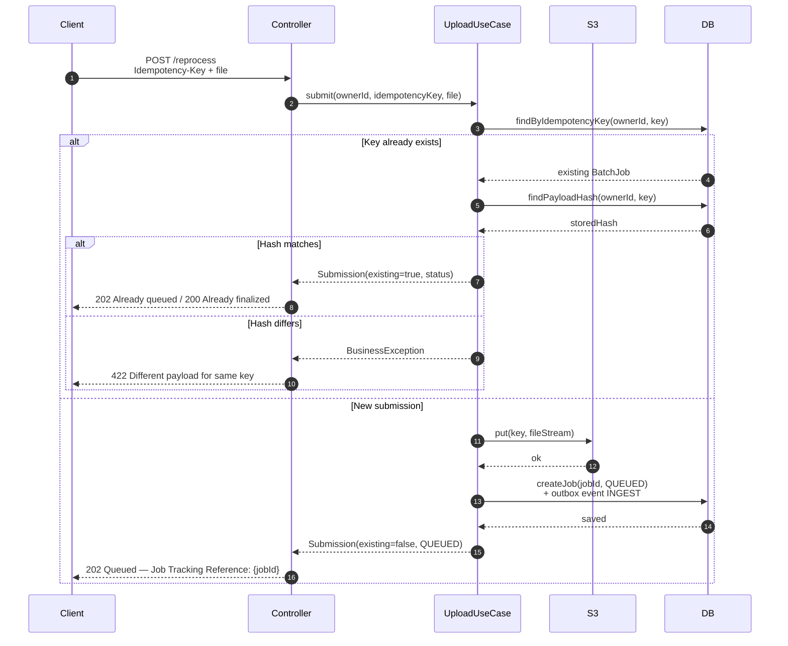
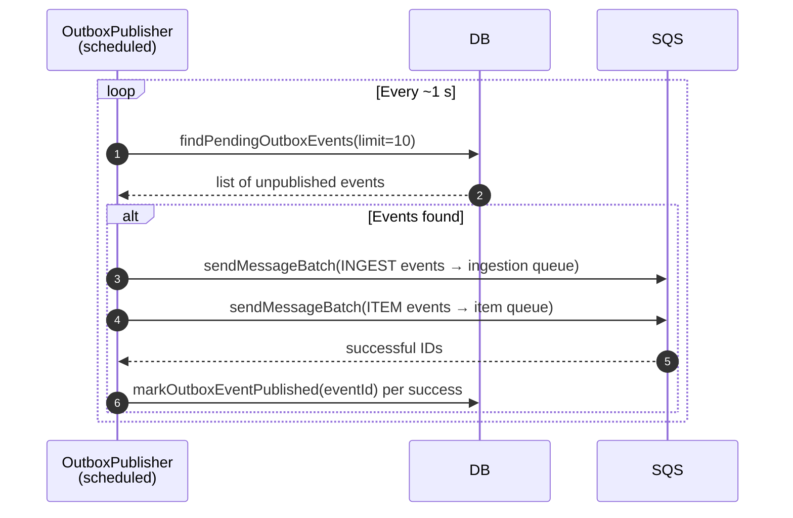
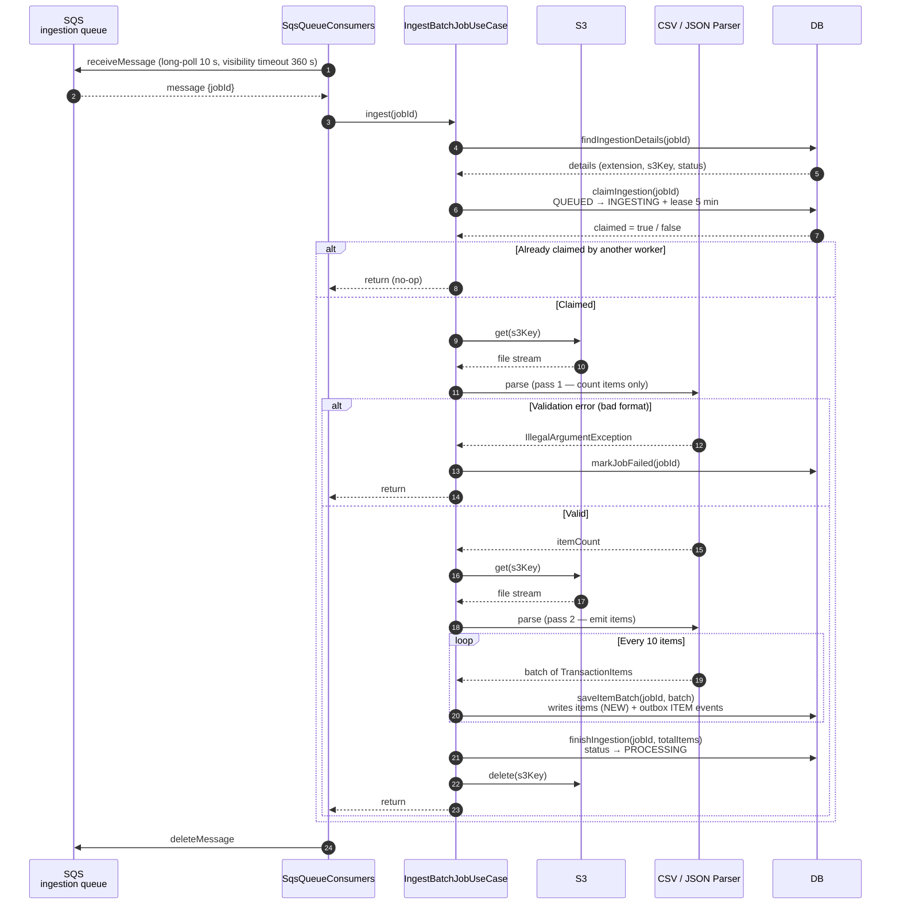
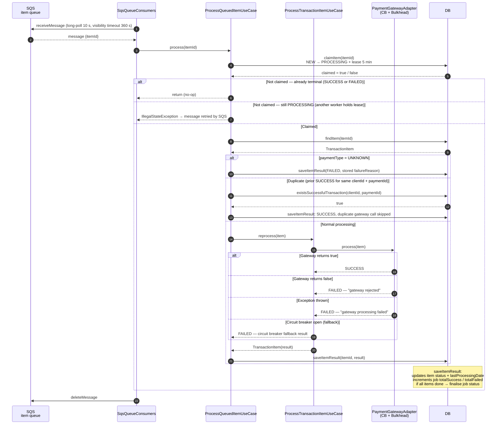
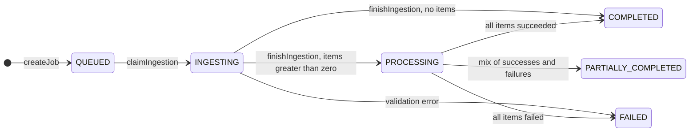
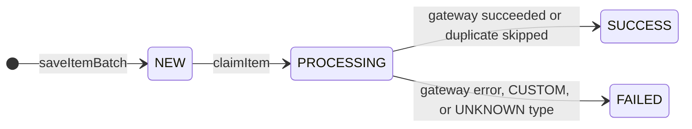

# Architecture

## Overview

The API accepts a CSV or JSON file, stores it in S3, and returns a job reference immediately
(`202 Accepted`). A background pipeline then ingests the file and processes each payment item
independently. Clients poll two read endpoints to track progress.

The pipeline has three stages. The upload is synchronous; ingestion and item processing are
asynchronous and use SQS. A persistence outbox bridges database writes and queue publication.

```
  POST /reprocess          Outbox → SQS          SQS → Worker
 ┌──────────────┐        ┌───────────────┐      ┌─────────────────────┐
 │  1. Upload   │──────► │  2. Ingest    │────► │  3. Process items   │
 │   (sync)     │        │   (async)     │      │      (async)        │
 └──────────────┘        └───────────────┘      └─────────────────────┘
  returns jobId           reads S3, writes        one message per item,
  (202 Accepted)          items to DB             calls payment gateway
```

The upload request calculates a SHA-256 payload hash before storing the file in S3. No response-time
guarantee is made. PostgreSQL writes the job and its outbox event in one database transaction;
DynamoDB currently writes them in separate calls, so its outbox is not transactionally atomic.

---

## Module map

```
src/main/java/com/virgolim/paymentapi/
│
├── domain/
│   ├── model/          BatchJob, TransactionItem, PaymentType, ProcessingStatus
│   └── exception/      BusinessException, ResourceNotFoundException
│
├── usecase/
│   ├── UploadBatchFileUseCase        (sync, called by controller)
│   ├── IngestBatchJobUseCase         (async, called by SQS consumer)
│   ├── ProcessQueuedItemUseCase      (async, called by SQS consumer)
│   └── ProcessTransactionItemUseCase (called by ProcessQueuedItemUseCase)
│
└── infra/
    ├── web/            REST endpoints + DTOs
    ├── security/       JWT filter + SecurityConfig
    ├── extraction/     CSV and JSON streaming parsers
    ├── storage/        S3-compatible object storage
    ├── queue/          SqsQueueConsumers (polling) + OutboxPublisher (scheduled)
    ├── payment/        PaymentGatewayFactory + gateway adapters
    ├── persistence/
    │   ├── BatchJobRepository          (domain port / interface)
    │   ├── adapter/                    PostgreSQL implementation
    │   └── dynamodb/                   DynamoDB implementation  ← default profile
    └── config/         AwsClientConfig, SecurityConfig, PaymentCloudProperties
```

---

## Security

Every `/api/v1/payments/**` request must carry a Bearer JWT with the `PAYMENT_OPERATOR` role.
The filter runs before Spring Security's username/password authentication filter.

The `Authorization` header must use the `Bearer <JWT>` format. Although the API requires
`ROLE_PAYMENT_OPERATOR`, the current filter assigns that authority to every valid token; it does
not validate a role claim. A production identity integration should validate the caller's
authorization claims rather than granting the role unconditionally.

```
Client ──► JwtAuthenticationFilter ──► Spring Security ──► Controller
              verifies signature,            requires ROLE_PAYMENT_OPERATOR
              extracts sub, grants role
```

The filter grants `ROLE_PAYMENT_OPERATOR` to every successfully validated JWT; it does not read or
validate a role claim. The `sub` claim becomes the `ownerId` that scopes job reads, so a caller can
only read jobs associated with that subject. `GET /actuator/health` and its subpaths are public.
All other paths require authentication.

---

## Flow 1 — Upload (synchronous)

`POST /api/v1/payments/reprocess`



**What is written:** S3 object + logical batch-job record (status `QUEUED`) + outbox event (type
`INGEST`). PostgreSQL commits the job and outbox event in one transaction. DynamoDB writes them
separately.

**Error handling:** missing/empty `Idempotency-Key` and unsupported file extension → 400;
empty file, missing filename extension, or a reused key with a different payload → 422. The
PostgreSQL implementation handles a unique-key race by deleting the orphaned S3 object and
returning the matching existing submission when its hash is the same. DynamoDB does not use a
conditional write for job creation, so the same race-safety guarantee does not apply there.

---

## Flow 2 — Outbox to SQS (scheduled)

`OutboxPublisher` runs every ~1 s by default (configurable) and bridges the persistence layer with
SQS. It reads at most ten eligible events per poll.



**Why it exists:** the outbox allows pending work to be published after database writes. In
PostgreSQL, the job/item records and their outbox rows are committed transactionally. In DynamoDB,
the records and outbox events are separate calls, so a crash between calls can leave them
inconsistent. Failed SQS sends remain pending for a later poll; if sending succeeds but marking the
event as published fails, the event can be sent again. Delivery is therefore at least once, not
exactly once.

---

## Flow 3 — Ingestion (asynchronous)

`SqsQueueConsumers.pollIngestionQueue` → `IngestBatchJobUseCase`



**What is written per item:** transaction-item record (status `NEW`, with `failureReason`
pre-filled for `UNKNOWN` types) + outbox event (type `ITEM`). The item events are not eligible for
publication until ingestion is complete and the job is in `PROCESSING`.

**Unknown payment types (e.g. PIX):** accepted without error. The item is stored with `paymentType = UNKNOWN` and a `failureReason` set at parse time. The gateway is never called for these items.

---

## Flow 4 — Item processing (asynchronous)

`SqsQueueConsumers.pollItemQueue` → `ProcessQueuedItemUseCase` → `ProcessTransactionItemUseCase`



The consumer receives one message per poll with a 10-second long poll and 360-second visibility
timeout. A successful return from the use case causes the message to be deleted. Exceptions that
escape the use case are logged and leave the message for SQS redelivery after the visibility
timeout.

**Job finalisation rule (inside `saveItemResult`):**

```
if ingestionComplete AND totalSuccess + totalFailed >= totalItems:
    totalFailed  = 0            → COMPLETED
    totalSuccess = 0            → FAILED
    both > 0                    → PARTIALLY_COMPLETED
```

---

## Flow 5 — Reading results (synchronous)


---

## Job and item lifecycle

**Batch job lifecycle**



**Transaction item lifecycle**



---

## Persistence and profiles

`BatchJobRepository` is the single persistence port. Two implementations are provided:

| Profile | Implementation | Tables / collections |
|---|---|---|
| `dynamodb` (default) | `DynamoBatchJobRepository` | `payment-api-batch-jobs`, `payment-api-transaction-items`, `payment-api-outbox-events` |
| `postgresql` | `BatchJobRepositoryAdapter` (JPA) | `batch_jobs`, `transaction_items`, `outbox_events` |

The DynamoDB adapter uses three GSIs: `IdempotencyKeyIndex` (idempotency lookup), `BatchJobIndex`
(item-by-job queries), and `LedgerIndex` (duplicate transaction check).

The DynamoDB implementation does not make related writes across its tables atomic. PostgreSQL wraps
related persistence operations in database transactions, but neither backend makes database updates
and SQS publication atomic; the outbox does not provide exactly-once delivery end to end.

---

## Error handling summary

| Stage | Error | Outcome |
|---|---|---|
| Upload | Missing or empty `Idempotency-Key` | 400 — `IllegalArgumentException` |
| Upload | Empty file, missing extension, or different payload for an existing key | 422 — `BusinessException` |
| Upload | Unsupported file extension | 400 — `IllegalArgumentException` |
| Upload | PostgreSQL unique-key race with matching payload | Orphaned S3 object deleted; existing submission returned |
| Upload | DynamoDB concurrent creation with the same idempotency key | No conditional write; duplicate job creation is not prevented |
| Ingest | File format invalid (bad headers / dates) | `markJobFailed` → job `FAILED`, message deleted |
| Ingest | S3 read error | `UncheckedIOException` propagated; message retried by SQS |
| Item | `paymentType = UNKNOWN` | Item `FAILED` with original type in `failureReason`; no gateway call |
| Item | `paymentType = CUSTOM` (no adapter registered) | Item `FAILED` — "Payment gateway processing failed." |
| Item | Gateway returns false | Item `FAILED` — "Payment gateway rejected reprocessing." |
| Item | Exception in gateway | Item `FAILED` — "Payment gateway processing failed." |
| Item | Circuit breaker open | Fallback records an `FAILED` item result; use case returns normally and the message is deleted (not retried by SQS) |
| Item | Item is not claimed and is not terminal | `IllegalStateException`; message remains for SQS redelivery after the visibility timeout |
| Item | Already terminal (SUCCESS/FAILED) | Silent no-op; message deleted |
| Read | Job not found or wrong owner | 404 — `ResourceNotFoundException` |

---

## Production limitations (showcase scope)

- **No DLQs.** Messages that keep failing are retried until SQS retention expires. Add DLQs and
  redrive policies to both queues before production use.
- **Non-atomic DynamoDB writes.** Job and outbox events, item records and item outbox events, and
  item results and job counters are written in separate calls. A crash between calls can cause
  inconsistency. In particular, DynamoDB `markJobFailed` does not update or fail already-created
  item records, unlike the PostgreSQL implementation. Production deployments should use DynamoDB
  transactions and conditional updates.
- **Outbox polling.** `findPendingOutboxEvents` scans the full table in DynamoDB. PostgreSQL uses
  an eligibility query joining outbox events, jobs, and (for item events) transaction items.
  At scale, assess a time-partitioned GSI or a CDC-based publisher.
- **Simulated gateways.** `CreditCardGatewayAdapter`, `DebitCardGatewayAdapter`, and
  `BankTransferGatewayAdapter` always return `true`. Real integrations must use provider-supported
  idempotency keys and reconcile uncertain outcomes.
- **Single EC2 instance.** The AWS environment runs one host. There is no horizontal scaling,
  auto-recovery, or scheduled shutdown.
