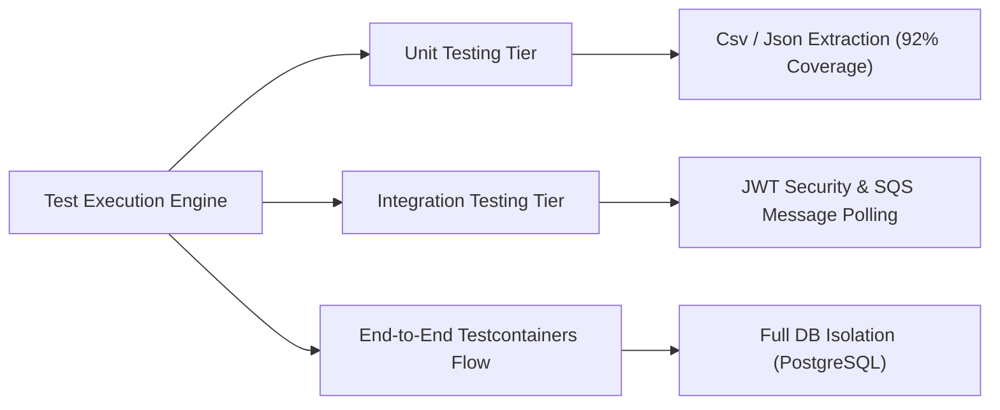
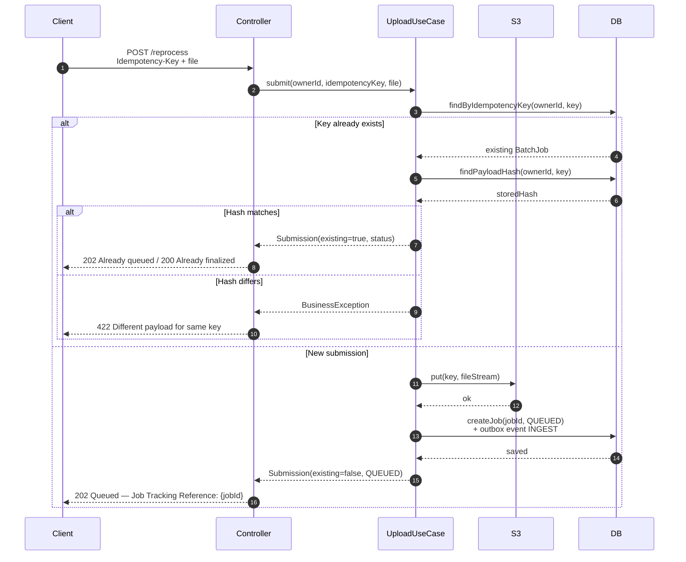
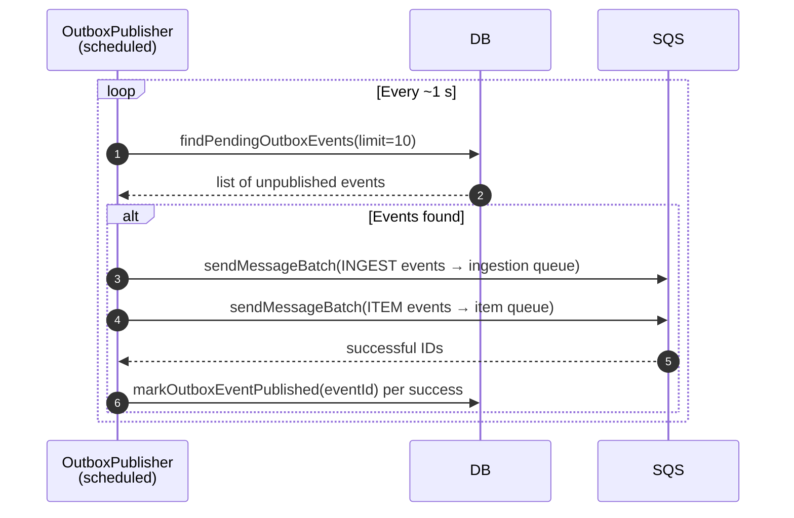
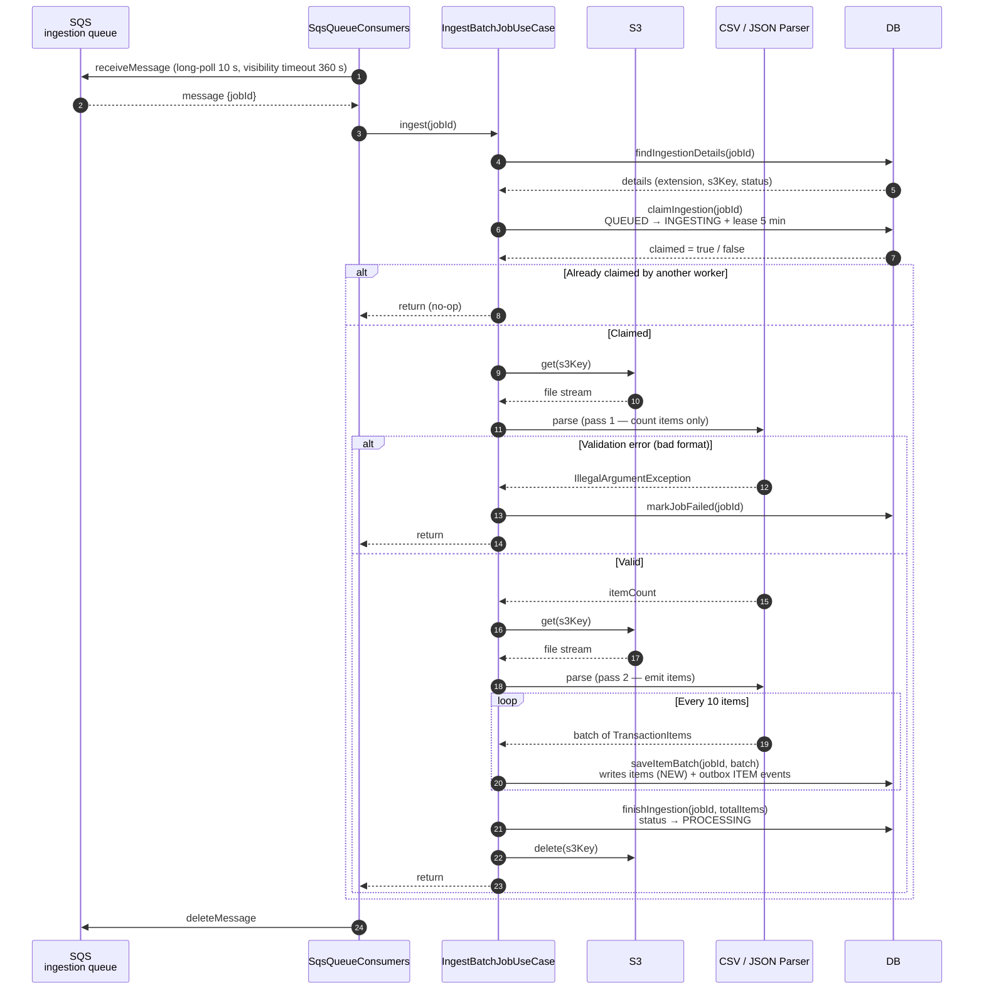
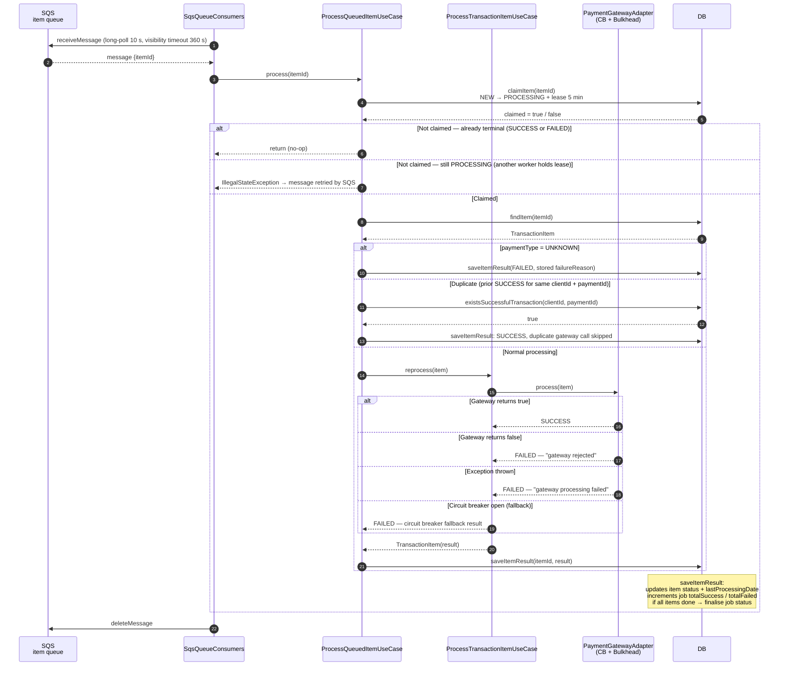
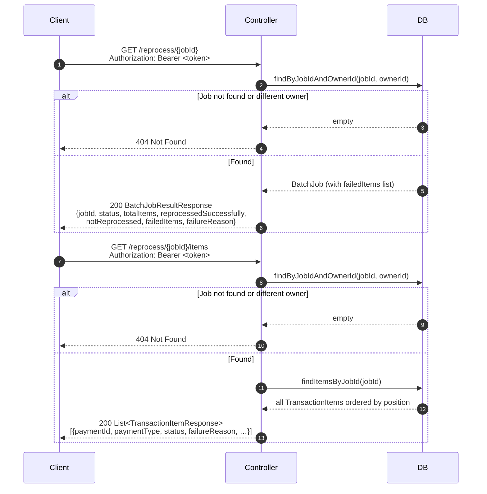
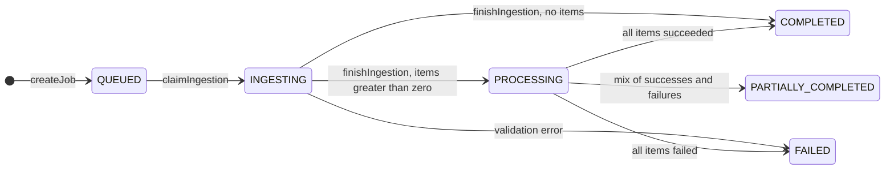
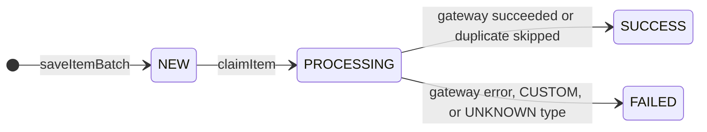

> **💼 Available for Contracts, Fractional Consulting, and Backend System Remediation (US/EU Timezones).**  
> This repository serves as a public technical showcase of production-grade Java & Spring Boot distributed systems engineering. The underlying source code is proprietary and securely hosted in a private repository. Full access for source audits, technical assessments, or prospective client reviews can be granted upon request.
>
> ✉️ **Request source access:** `edo.virgolim@gmail.com`
>
> GitHub Showcase: https://github.com/edovirgolim/payment-reprocessing-api-showcase


# 🚀 High-Throughput Asynchronous Payment Reprocessing Pipeline
## Enterprise Java & Spring Boot Showcase


<p align="left">
  <strong>☕ Java 21</strong> &nbsp; • &nbsp; <strong>🍃 Spring Boot 3</strong> &nbsp; • &nbsp; <strong>🛡️ Resilience4j</strong> &nbsp; • &nbsp; <strong>☁️ AWS SDK Integration</strong>
</p>


---

## 🗺️ Table of Contents

* [👨‍💻 Behind the Architecture: Meet the Engineer](#-behind-the-architecture-meet-the-engineer)
* [📌 The Core Business Problem](#-the-core-business-problem)
* [📐 Architecture & System Design Decisions](#-architecture--system-design-decisions)
  * [Deep-Dive Systems Architecture & Diagrams](#%EF%B8%8F-deep-dive-systems-architecture--diagrams)
  * [Advanced Architectural Patterns Demonstrated](#-advanced-architectural-patterns-demonstrated)
* [🛠️ Enterprise-Grade Stack](#%EF%B8%8F-enterprise-grade-stack)
* [🗺️ Clean Architecture Component Map](#%EF%B8%8F-clean-architecture-component-map)
* [🧪 Automated Testing & Code Quality Strategy](#-automated-testing--code-quality-strategy)
  * [📊 Testing Metrics & Live Execution Summary](#-testing-metrics--live-execution-summary)
  * [🛠️ Advanced Testing Concepts Implemented](#%EF%B8%8F-advanced-testing-concepts-implemented)
* [🚀 Engineering Capabilities (How I Can Help Your Business)](#-engineering-capabilities-how-i-can-help-your-business)
* [🤝 Let's Connect](#-lets-connect)
* [# Architecture](#architecture)
  * [Overview](#overview)
  * [Module map](#module-map)
  * [Security](#security)
  * [Flow 1 — Upload (synchronous)](#flow-1--upload-synchronous)
  * [Flow 2 — Outbox to SQS (scheduled)](#flow-2--outbox-to-sqs-scheduled)
  * [Flow 3 — Ingestion (asynchronous)](#flow-3--ingestion-asynchronous)
  * [Flow 4 — Item processing (asynchronous)](#flow-4--item-processing-asynchronous)
  * [Flow 5 — Reading results (synchronous)](#flow-5--reading-results-synchronous)
  * [Job and item lifecycle](#job-and-item-lifecycle)
  * [Persistence and profiles](#persistence-and-profiles)
  * [Error handling summary](#error-handling-summary)
  * [Production limitations (showcase scope)](#production-limitations-showcase-scope)


---

## 👨‍💻 Behind the Code: Meet the Engineer

Hi, I'm **Edo Virgolim**, a **Senior Software Engineer with over 20 years of hands-on experience** building high-scale Java backend systems, event-driven microservices, and resilient distributed pipelines for international clients across the US and Europe.

Throughout my career, I have engineered backend services processing **100k+ daily requests**, integrated generative AI into Spring Boot workflows to deflect support overhead by 40%, and delivered mission-critical code within strict **European financial compliance frameworks (ING Bank, Netherlands)**.

### Why I built this showcase:
As a senior enterprise developer, my production codebases live securely behind corporate NDAs. I built this independent, end-to-end payment reprocessing pipeline to publicly demonstrate my Java 21 & Spring Boot 3 coding standards, automated testing rigor, concurrency patterns, and ability to integrate seamlessly with cloud messaging and storage services. When you hire me, this is the caliber of backend engineering you bring to your team.

---

## 📌 The Core Business Problem

Processing large transaction batches from unstructured source files introduces severe distributed consistency risks. File uploads can be retried mid-way through transient network blips, upstream clients can submit identical batches multiple times, and asynchronous message brokers might deliver a processing event more than once due to *at-least-once* delivery guarantees.

Without strict architectural safeguards, **businesses suffer from duplicate payouts, corrupted ledgers, customer overcharges, and expensive infrastructure waste**.

This showcase implements a bulletproof, decoupled, asynchronous processing pipeline engineered to handle network failures gracefully, guaranteeing strict idempotency, auditability, and data integrity at scale.

---

## 📐 Architecture & System Design Decisions

The system is architected using **Clean Architecture** and **Domain-Driven Design (DDD)** principles. This keeps the core financial rules completely decoupled from infrastructure details like AWS services, databases, or transport frameworks.

```text
  POST /reprocess          Outbox → SQS               SQS → Worker
 ┌────────────────┐      ┌───────────────┐      ┌──────────────────────┐
 │   1. Upload    │─────►│   2. Ingest   │─────►│   3. Process Items   │
 │ (Synchronous)  │      │(Asynchronous) │      │    (Asynchronous)    │
 └────────────────┘      └───────────────┘      └──────────────────────┘
   Returns jobId           Reads S3, writes       One message per item,
   in < 1 Second           items to DB            triggers payment gateway
```

### 🗺️ Deep-Dive Systems Architecture & Diagrams

The complete design specifications—including **Mermaid sequence diagrams** for every pipeline stage, comprehensive state machine transitions for jobs/items, and a full failure-mode matrix—are thoroughly detailed in our dedicated architecture document at the root of this project: **[ARCHITECTURE.md](ARCHITECTURE.md)**


| Architectural Blueprint | What It Unlocks |
|---|---|
| [Flow 1 — Synchronous Upload](ARCHITECTURE.md#flow-1--upload-synchronous) | SHA-256 payload validation, multi-tier idempotency checks, and validation error handling (400/422). |
| [Flow 2 — Transactional Outbox](ARCHITECTURE.md#flow-2--outbox-to-sqs-scheduled) | Scheduled event loop bridging the database state with SQS queue delivery guarantees. |
| [Flow 3 — Async File Ingestion](ARCHITECTURE.md#flow-3--ingestion-asynchronous) | S3 two-pass stream chunking, worker lease claims, and isolated unknown payment token routing. |
| [Flow 4 — Resilient Item Processing](ARCHITECTURE.md#flow-4--item-processing-asynchronous) | Fault isolation through bulkheads, circuit breaker fallbacks, and ledger deduplication. |

---

### 🧠 Advanced Architectural Patterns Demonstrated:

*   **Multi-Tiered Idempotency:** Double-guard protection using a payload SHA-256 hash at the boundary and transaction-level idempotency keys cross-referenced via a high-performance database index (`LedgerIndex`). This completely prevents duplicate operations even during intense race conditions.
*   **Transactional Outbox Pattern:** Guarantees eventual consistency. Messages are never dispatched directly inside the database transaction context—avoiding lost messages or distributed locking. Instead, data and events are written to the same storage state in a single unit of work and published by a background loop.
*   **Zero-Memory File Streaming:** Incremental, low-footprint CSV and JSON streaming parsers process chunks straight out of Amazon S3, avoiding memory spikes (`OutOfMemoryError`) even under heavy production file loads.
*   **Downstream Fault Isolation:** External payment gateways are isolated using **Circuit Breakers** and **Bulkheads** (via Resilience4j). If an external provider degrades, the circuit fallback safely isolates the failure, updates the ledger, and allows the remaining SQS processing queue to flow without worker starvation.
*   **Database Agnostic Persistence:** Out-of-the-box support for both high-scalability NoSQL (**Amazon DynamoDB**) and traditional relational structures (**PostgreSQL**), flipped dynamically via native runtime Spring profiles.

---

## 🛠️ Enterprise-Grade Stack

*   **Core Engineering:** Java 21 (Virtual Threads ready) & Spring Boot 3.x
*   **Messaging & Queues:** Amazon SQS (Spring Cloud / AWS SDK integration)
*   **Object Storage:** Amazon S3 (Streaming file consumption)
*   **Persistence Layers:** Amazon DynamoDB (modeled with 3 optimized Global Secondary Indexes) & PostgreSQL (fully versioned with Flyway schema migrations)
*   **Resiliency & Stability:** Resilience4j (Circuit Breakers, Bulkheads, Fallback mechanisms)
*   **Security:** Stateless JWT authentication mapping granular role-based access controls (`PAYMENT_OPERATOR`) scoped strictly to tenant/subject boundaries
*   **Demo Environment & Local Setup:** Docker, Testcontainers, and reproducible Terraform scripts for spinning up the showcase sandbox.


---

## 🗺️ Clean Architecture Component Map

Strict separation of concerns ensures that business logic never bleeds into external frameworks, letting you fix bugs, refactor modules, or switch database backends rapidly without breaking the core engine:

```text
src/main/
├── java/com/virgolim/paymentapi/
│   ├── domain/                 # Pure domain models (BatchJob, TransactionItem) & core invariants
│   ├── usecase/                # Application workflows & pure orchestrators (Upload, Ingestion, Processing)
│   └── infra/                  # Technological details, frameworks & low-coupling implementations
│       ├── config/             # AWS Client SDK setups, Resilience4j beans, and Security configurations
│       ├── extraction/         # High-efficiency streaming CSV/JSON parsers
│       ├── payment/            # Gateway abstraction factory and external payment system adapters
│       ├── persistence/        # Decoupled repository adapters for DynamoDB & PostgreSQL
│       ├── queue/              # SQS message consumers & outbox scheduling engine
│       ├── security/           # JWT filtering, verification, and tenant owner boundary isolation
│       └── web/                # HTTP REST controllers and immutable input/output DTOs
└── resources/
    ├── db/migration/           # Fully versioned PostgreSQL relational schema evolution (Flyway)
    └── application.yaml        # Active cloud profiles and runtime property definitions
└── test/
    └── java/com/virgolim/paymentapi/
        ├── infra/              # Integration tests for Web Controllers, JWT, and SQS
        │   └── web/            # PaymentReprocessingController & EndToEnd Testcontainers
        └── usecase/            # Unit tests verifying application business rules
```

---

## 🧪 Automated Testing & Code Quality Strategy

The reliability of a core financial engine cannot rely on manual validation. This project features a comprehensive, multi-tiered automated testing suite consisting of **15 test suites and 56 fully automated assertions**, verifying everything from boundary parsing edge cases to full cloud event cycles.



### 📊 Testing Metrics & Live Execution Summary

The test suite generates native **JaCoCo coverage metrics** and executes seamlessly against localized environment layers:

| Target Area | Test Suite / Components Covered | Assertions | Focus Type |
|---|---|:---:|---|
| **E2E Pipeline** | `PaymentReprocessingEndToEndIntegrationTest` | **9** | Full Multi-Stage System Cycle |
| **Web / Boundary** | `PaymentReprocessingControllerIntegrationTest`, `GlobalExceptionHandlerTest` | **8** | HTTP Contracts & Schema Validation |
| **Security** | `JwtAuthenticationFilterTest` | **3** | RBAC Auth, Tenant Boundary Isolation |
| **Async / Queues** | `OutboxPublisherTest`, `SqsQueueConsumersTest` | **5** | SQS Consumers & Event Outbox Delivery |
| **Data Extraction**| `CsvExtractionStrategyTest`, `JsonExtractionStrategyTest`, `ExtractionFactory` | **15** | High-Efficiency Zero-Memory Streaming |
| **Business Logic** | `ProcessQueuedItemUseCaseTest`, `ProcessTransactionItemUseCaseTest`, `UploadBatchFileUseCase` | **12** | Pure Domain Orchestrators & Rules |
| **Persistence** | `BatchJobRepositoryAdapterTest`, `DynamoDbSchemaTest` | **4** | Repository Adapters & Schema Specs |

### 🛠️ Advanced Testing Concepts Implemented

*   **Real Database Sanity via Testcontainers:** E2E flows (`PaymentReprocessingEndToEndIntegrationTest`) spin up an isolated, ephemeral PostgreSQL instance inside real Docker containers during runtime. This avoids fragile mocking of the database layer and mirrors real production behavior.
*   **High-Fidelity Stream Parsing Validation:** Heavy validation on data ingestion (achieving **92% line coverage** on stream-based parsing engines) ensuring broken rows, malformed headers, or zero-byte files fail early with proper validation responses.
*   **Stateless Security & Filter Mocking:** Rigorous testing on JWT verification filters, asserting correct request rejection on mismatched signatures or expired token payloads.

---

## 🚀 Engineering Capabilities (How I Can Help Your Team)

If you are experiencing backend scaling bottlenecks, chasing race conditions in production, or need a senior Java engineer to turn complex requirements into clean, tested code, I apply the patterns proven in this repository to deliver:

1.  **Greenfield Java / Spring Boot Microservices:** Crafting modern, secure, and well-tested backend services prepared for horizontal scaling.
2.  **Concurrency & Race-Condition Remediation:** Auditing and fixing critical bugs where distributed applications double-charge customers or drop messages during high-traffic spikes.
3.  **Legacy Modernization (Clean Architecture / DDD):** Refactoring brittle monolithic Java codebases into modular, testable, and highly maintainable service layers.
4.  **High-Performance Data Modeling & Persistence:** Optimizing relational queries (PostgreSQL/Oracle/SQL Server) or designing fast access patterns in DynamoDB and MongoDB.
5.  **Automated Testing & Quality Engineering:** Implementing high-coverage unit and integration test suites using JUnit 5, Mockito, and Testcontainers to guarantee regression-free releases.

---

## 🤝 Let's Connect

*   📬 **Direct Inquiries:** `edo.virgolim@gmail.com`
*   💼 **LinkedIn:** [https://www.linkedin.com/in/edovirgolim/](https://www.linkedin.com/in/edovirgolim/)
*   🐱 **Github Profile:** [https://github.com/edovirgolim](https://github.com/edovirgolim)

*Are you a tech lead or engineering manager evaluating my capabilities? Drop me an email to request complete read-access to the private repository, where you can deeply evaluate my code quality, enterprise commit hygiene, and advanced Testcontainers integration suites.*


---

# Architecture

## Overview

The API accepts a CSV or JSON file, stores it in S3, and returns a job reference immediately
(`202 Accepted`). A background pipeline then ingests the file and processes each payment item
independently. Clients poll two read endpoints to track progress.

The pipeline has three stages. The upload is synchronous; ingestion and item processing are
asynchronous and use SQS. A persistence outbox bridges database writes and queue publication.

```
  POST /reprocess          Outbox → SQS          SQS → Worker
 ┌──────────────┐        ┌───────────────┐      ┌─────────────────────┐
 │  1. Upload   │──────► │  2. Ingest    │────► │  3. Process items   │
 │   (sync)     │        │   (async)     │      │      (async)        │
 └──────────────┘        └───────────────┘      └─────────────────────┘
  returns jobId           reads S3, writes        one message per item,
  (202 Accepted)          items to DB             calls payment gateway
```

The upload request calculates a SHA-256 payload hash before storing the file in S3. No response-time
guarantee is made. PostgreSQL writes the job and its outbox event in one database transaction;
DynamoDB currently writes them in separate calls, so its outbox is not transactionally atomic.

---

## Module map

```
src/main/java/com/virgolim/paymentapi/
│
├── domain/
│   ├── model/          BatchJob, TransactionItem, PaymentType, ProcessingStatus
│   └── exception/      BusinessException, ResourceNotFoundException
│
├── usecase/
│   ├── UploadBatchFileUseCase        (sync, called by controller)
│   ├── IngestBatchJobUseCase         (async, called by SQS consumer)
│   ├── ProcessQueuedItemUseCase      (async, called by SQS consumer)
│   └── ProcessTransactionItemUseCase (called by ProcessQueuedItemUseCase)
│
└── infra/
    ├── web/            REST endpoints + DTOs
    ├── security/       JWT filter + SecurityConfig
    ├── extraction/     CSV and JSON streaming parsers
    ├── storage/        S3-compatible object storage
    ├── queue/          SqsQueueConsumers (polling) + OutboxPublisher (scheduled)
    ├── payment/        PaymentGatewayFactory + gateway adapters
    ├── persistence/
    │   ├── BatchJobRepository          (domain port / interface)
    │   ├── adapter/                    PostgreSQL implementation
    │   └── dynamodb/                   DynamoDB implementation  ← default profile
    └── config/         AwsClientConfig, SecurityConfig, PaymentCloudProperties
```

---

## Security

Every `/api/v1/payments/**` request must carry a Bearer JWT with the `PAYMENT_OPERATOR` role.
The filter runs before Spring Security's username/password authentication filter.

The `Authorization` header must use the `Bearer <JWT>` format. Although the API requires
`ROLE_PAYMENT_OPERATOR`, the current filter assigns that authority to every valid token; it does
not validate a role claim. A production identity integration should validate the caller's
authorization claims rather than granting the role unconditionally.

```
Client ──► JwtAuthenticationFilter ──► Spring Security ──► Controller
              verifies signature,            requires ROLE_PAYMENT_OPERATOR
              extracts sub, grants role
```

The filter grants `ROLE_PAYMENT_OPERATOR` to every successfully validated JWT; it does not read or
validate a role claim. The `sub` claim becomes the `ownerId` that scopes job reads, so a caller can
only read jobs associated with that subject. `GET /actuator/health` and its subpaths are public.
All other paths require authentication.

---

## Flow 1 — Upload (synchronous)

`POST /api/v1/payments/reprocess`



**What is written:** S3 object + logical batch-job record (status `QUEUED`) + outbox event (type
`INGEST`). PostgreSQL commits the job and outbox event in one transaction. DynamoDB writes them
separately.

**Error handling:** missing/empty `Idempotency-Key` and unsupported file extension → 400;
empty file, missing filename extension, or a reused key with a different payload → 422. The
PostgreSQL implementation handles a unique-key race by deleting the orphaned S3 object and
returning the matching existing submission when its hash is the same. DynamoDB does not use a
conditional write for job creation, so the same race-safety guarantee does not apply there.

---

## Flow 2 — Outbox to SQS (scheduled)

`OutboxPublisher` runs every ~1 s by default (configurable) and bridges the persistence layer with
SQS. It reads at most ten eligible events per poll.



**Why it exists:** the outbox allows pending work to be published after database writes. In
PostgreSQL, the job/item records and their outbox rows are committed transactionally. In DynamoDB,
the records and outbox events are separate calls, so a crash between calls can leave them
inconsistent. Failed SQS sends remain pending for a later poll; if sending succeeds but marking the
event as published fails, the event can be sent again. Delivery is therefore at least once, not
exactly once.

---

## Flow 3 — Ingestion (asynchronous)

`SqsQueueConsumers.pollIngestionQueue` → `IngestBatchJobUseCase`



**What is written per item:** transaction-item record (status `NEW`, with `failureReason`
pre-filled for `UNKNOWN` types) + outbox event (type `ITEM`). The item events are not eligible for
publication until ingestion is complete and the job is in `PROCESSING`.

**Unknown payment types (e.g. PIX):** accepted without error. The item is stored with `paymentType = UNKNOWN` and a `failureReason` set at parse time. The gateway is never called for these items.

---

## Flow 4 — Item processing (asynchronous)

`SqsQueueConsumers.pollItemQueue` → `ProcessQueuedItemUseCase` → `ProcessTransactionItemUseCase`



The consumer receives one message per poll with a 10-second long poll and 360-second visibility
timeout. A successful return from the use case causes the message to be deleted. Exceptions that
escape the use case are logged and leave the message for SQS redelivery after the visibility
timeout.

**Job finalisation rule (inside `saveItemResult`):**

```
if ingestionComplete AND totalSuccess + totalFailed >= totalItems:
    totalFailed  = 0            → COMPLETED
    totalSuccess = 0            → FAILED
    both > 0                    → PARTIALLY_COMPLETED
```

---

## Flow 5 — Reading results (synchronous)



---

## Job and item lifecycle

**Batch job lifecycle**



**Transaction item lifecycle**



---

## Persistence and profiles

`BatchJobRepository` is the single persistence port. Two implementations are provided:

| Profile | Implementation | Tables / collections |
|---|---|---|
| `dynamodb` (default) | `DynamoBatchJobRepository` | `payment-api-batch-jobs`, `payment-api-transaction-items`, `payment-api-outbox-events` |
| `postgresql` | `BatchJobRepositoryAdapter` (JPA) | `batch_jobs`, `transaction_items`, `outbox_events` |

The DynamoDB adapter uses three GSIs: `IdempotencyKeyIndex` (idempotency lookup), `BatchJobIndex`
(item-by-job queries), and `LedgerIndex` (duplicate transaction check).

The DynamoDB implementation does not make related writes across its tables atomic. PostgreSQL wraps
related persistence operations in database transactions, but neither backend makes database updates
and SQS publication atomic; the outbox does not provide exactly-once delivery end to end.

---

## Error handling summary

| Stage | Error | Outcome |
|---|---|---|
| Upload | Missing or empty `Idempotency-Key` | 400 — `IllegalArgumentException` |
| Upload | Empty file, missing extension, or different payload for an existing key | 422 — `BusinessException` |
| Upload | Unsupported file extension | 400 — `IllegalArgumentException` |
| Upload | PostgreSQL unique-key race with matching payload | Orphaned S3 object deleted; existing submission returned |
| Upload | DynamoDB concurrent creation with the same idempotency key | No conditional write; duplicate job creation is not prevented |
| Ingest | File format invalid (bad headers / dates) | `markJobFailed` → job `FAILED`, message deleted |
| Ingest | S3 read error | `UncheckedIOException` propagated; message retried by SQS |
| Item | `paymentType = UNKNOWN` | Item `FAILED` with original type in `failureReason`; no gateway call |
| Item | `paymentType = CUSTOM` (no adapter registered) | Item `FAILED` — "Payment gateway processing failed." |
| Item | Gateway returns false | Item `FAILED` — "Payment gateway rejected reprocessing." |
| Item | Exception in gateway | Item `FAILED` — "Payment gateway processing failed." |
| Item | Circuit breaker open | Fallback records an `FAILED` item result; use case returns normally and the message is deleted (not retried by SQS) |
| Item | Item is not claimed and is not terminal | `IllegalStateException`; message remains for SQS redelivery after the visibility timeout |
| Item | Already terminal (SUCCESS/FAILED) | Silent no-op; message deleted |
| Read | Job not found or wrong owner | 404 — `ResourceNotFoundException` |

---

## Production limitations (showcase scope)

- **No DLQs.** Messages that keep failing are retried until SQS retention expires. Add DLQs and
  redrive policies to both queues before production use.
- **Non-atomic DynamoDB writes.** Job and outbox events, item records and item outbox events, and
  item results and job counters are written in separate calls. A crash between calls can cause
  inconsistency. In particular, DynamoDB `markJobFailed` does not update or fail already-created
  item records, unlike the PostgreSQL implementation. Production deployments should use DynamoDB
  transactions and conditional updates.
- **Outbox polling.** `findPendingOutboxEvents` scans the full table in DynamoDB. PostgreSQL uses
  an eligibility query joining outbox events, jobs, and (for item events) transaction items.
  At scale, assess a time-partitioned GSI or a CDC-based publisher.
- **Simulated gateways.** `CreditCardGatewayAdapter`, `DebitCardGatewayAdapter`, and
  `BankTransferGatewayAdapter` always return `true`. Real integrations must use provider-supported
  idempotency keys and reconcile uncertain outcomes.
- **Single EC2 instance.** The AWS environment runs one host. There is no horizontal scaling,
  auto-recovery, or scheduled shutdown.

---
© 2026 Edo Virgolim. All rights reserved.

*   📬 **Direct Inquiries:** `edo.virgolim@gmail.com`
*   💼 **LinkedIn:** [https://www.linkedin.com/in/edovirgolim/](https://www.linkedin.com/in/edovirgolim/)
*   🐱 **Github Profile:** [https://github.com/edovirgolim](https://github.com/edovirgolim)

