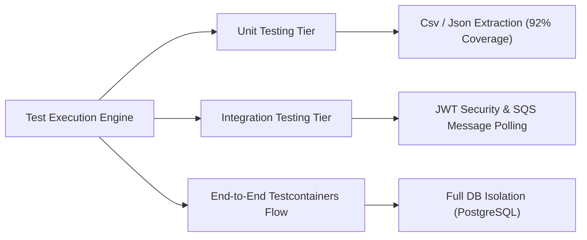

> **💼 Available for Contracts, Fractional Consulting, and High-Complexity System Remediation (US/EU Timezones).**  
> This repository serves as a public technical showcase of production-grade distributed systems engineering. The underlying source code is proprietary and securely hosted in a private repository. Full access for source audits, technical assessments, or prospective client reviews can be granted upon request. 
>
> ✉️ **Request source access:** `edo.virgolim@gmail.com`
>
> GitHub Showcase: https://github.com/edovirgolim/payment-reprocessing-api-showcase  


# 🚀 High-Throughput Asynchronous Payment Reprocessing Pipeline
## Enterprise Showcase


<p align="left">
  <strong>☕ Java 21</strong> &nbsp; • &nbsp; <strong>🍃 Spring Boot 3</strong> &nbsp; • &nbsp; <strong>☁️ AWS Architecture Ready</strong>
</p>


---

## 🗺️ Table of Contents

* [👨‍💻 Behind the Architecture: Meet the Engineer](#-behind-the-architecture-meet-the-engineer)
* [📌 The Core Business Problem](#-the-core-business-problem)
* [📐 Architecture & System Design Decisions](#-architecture--system-design-decisions)
  * [Deep-Dive Systems Architecture & Diagrams](#%EF%B8%8F-deep-dive-systems-architecture--diagrams)
  * [Advanced Architectural Patterns Demonstrated](#-advanced-architectural-patterns-demonstrated)
* [🛠️ Enterprise-Grade Stack](#%EF%B8%8F-enterprise-grade-stack)
* [🗺️ Clean Architecture Component Map](#%EF%B8%8F-clean-architecture-component-map)
* [🧪 Automated Testing & Code Quality Strategy](#-automated-testing--code-quality-strategy)
  * [📊 Testing Metrics & Live Execution Summary](#-testing-metrics--live-execution-summary)
  * [🛠️ Advanced Testing Concepts Implemented](#%EF%B8%8F-advanced-testing-concepts-implemented)
* [🚀 Engineering Capabilities (How I Can Help Your Business)](#-engineering-capabilities-how-i-can-help-your-business)
* [🤝 Let's Connect](#-lets-connect)

---

## 👨‍💻 Behind the Architecture: Meet the Engineer

Hi, I'm **Edo Virgolim**, a **Senior Software Engineer & Architect with over 20 years of hands-on experience** designing high-scale backend systems, complex event-driven architectures, and robust cloud pipelines for international clients across the US and Europe. 

Throughout my career, I have engineered systems processing **100k+ daily requests**, integrated generative AI to deflect support overhead by 40%, and worked within strict **European financial compliance frameworks (ING Bank, Netherlands)**. 

### Why I built this showcase:
As an enterprise engineer, my production codebases live securely behind corporate NDAs. I built this independent, end-to-end payment reprocessing pipeline to publicly demonstrate my engineering standards, code hygiene, architectural patterns, and ability to productionalize complex AWS topologies from scratch. When you hire me, this is the caliber of software engineering you bring to your team.

---

## 📌 The Core Business Problem

Processing large transaction batches from unstructured source files introduces severe distributed consistency risks. File uploads can be retried mid-way through transient network blips, upstream clients can submit identical batches multiple times, and asynchronous message brokers might deliver a processing event more than once due to *at-least-once* delivery guarantees.

Without strict architectural safeguards, **businesses suffer from duplicate payouts, corrupted ledgers, customer overcharges, and expensive infrastructure waste**.

This showcase implements a bulletproof, decoupled, asynchronous processing pipeline engineered to handle network failures gracefully, guaranteeing strict idempotency, auditability, and data integrity at scale.

---

## 📐 Architecture & System Design Decisions

The system is architected using **Clean Architecture** and **Domain-Driven Design (DDD)** principles. This keeps the core financial rules completely decoupled from infrastructure details like AWS services, databases, or transport frameworks.

```text
  POST /reprocess          Outbox → SQS               SQS → Worker
 ┌────────────────┐      ┌───────────────┐      ┌──────────────────────┐
 │   1. Upload    │─────►│   2. Ingest   │─────►│   3. Process Items   │
 │ (Synchronous)  │      │(Asynchronous) │      │    (Asynchronous)    │
 └────────────────┘      └───────────────┘      └──────────────────────┘
   Returns jobId           Reads S3, writes       One message per item,
   in < 1 Second           items to DB            triggers payment gateway
```

### 🗺️ Deep-Dive Systems Architecture & Diagrams

The complete design specifications—including **Mermaid sequence diagrams** for every pipeline stage, comprehensive state machine transitions for jobs/items, and a full failure-mode matrix—are thoroughly detailed in our dedicated architecture document at the root of this project:


| Architectural Blueprint | What It Unlocks |
|---|---|
| [Flow 1 — Synchronous Upload](README+ARCHITECTURE.md#flow-1--upload-synchronous) | SHA-256 payload validation, multi-tier idempotency checks, and validation error handling (400/422). |
| [Flow 2 — Transactional Outbox](README+ARCHITECTURE.md#flow-2--outbox-to-sqs-scheduled) | Scheduled event loop bridging the database state with SQS queue delivery guarantees. |
| [Flow 3 — Async File Ingestion](README+ARCHITECTURE.md#flow-3--ingestion-asynchronous) | S3 two-pass stream chunking, worker lease claims, and isolated unknown payment token routing. |
| [Flow 4 — Resilient Item Processing](README+ARCHITECTURE.md#flow-4--item-processing-asynchronous) | Fault isolation through bulkheads, circuit breaker fallbacks, and ledger deduplication. |

---

### 🧠 Advanced Architectural Patterns Demonstrated:

*   **Multi-Tiered Idempotency:** Double-guard protection using a payload SHA-256 hash at the boundary and transaction-level idempotency keys cross-referenced via a high-performance database index (`LedgerIndex`). This completely prevents duplicate operations even during intense race conditions.
*   **Transactional Outbox Pattern:** Guarantees eventual consistency. Messages are never dispatched directly inside the database transaction context—avoiding lost messages or distributed locking. Instead, data and events are written to the same storage state in a single unit of work and published by a background loop.
*   **Zero-Memory File Streaming:** Incremental, low-footprint CSV and JSON streaming parsers process chunks straight out of Amazon S3, avoiding memory spikes (`OutOfMemoryError`) even under heavy production file loads.
*   **Downstream Fault Isolation:** External payment gateways are isolated using **Circuit Breakers** and **Bulkheads** (via Resilience4j). If an external provider degrades, the circuit fallback safely isolates the failure, updates the ledger, and allows the remaining SQS processing queue to flow without worker starvation.
*   **Database Agnostic Persistence:** Out-of-the-box support for both high-scalability NoSQL (**Amazon DynamoDB**) and traditional relational structures (**PostgreSQL**), flipped dynamically via native runtime Spring profiles.

---

## 🛠️ Enterprise-Grade Stack

*   **Core Engineering:** Java 21 (Virtual Threads ready) & Spring Boot 3.x
*   **Cloud Messaging:** Amazon SQS (Simple Queue Service)
*   **Object Storage:** Amazon S3 (Simple Storage Service)
*   **Persistence Layers:** Amazon DynamoDB (modeled with 3 optimized Global Secondary Indexes) & PostgreSQL (fully versioned with Flyway schema migrations)
*   **Resiliency & Stability:** Resilience4j (Circuit Breakers, Bulkheads, Fallback mechanisms)
*   **Security:** Stateless JWT authentication mapping granular role-based access controls (`PAYMENT_OPERATOR`) scoped strictly to tenant/subject boundaries
*   **Infrastructure as Code:** Production-ready Terraform templates defining strict VPC network boundaries, EC2 compute topology, ECR repositories, S3 buckets, and On-Demand billing structures.

---

## 🗺️ Clean Architecture Component Map

Strict separation of concerns ensures that business logic never bleeds into external frameworks, letting you fix bugs, refactor modules, or switch database backends rapidly without breaking the core engine:

```text
src/main/
├── java/com/virgolim/paymentapi/
│   ├── domain/                 # Pure domain models (BatchJob, TransactionItem) & core invariants
│   ├── usecase/                # Application workflows & pure orchestrators (Upload, Ingestion, Processing)
│   └── infra/                  # Technological details, frameworks & low-coupling implementations
│       ├── config/             # AWS Client SDK setups, Resilience4j beans, and Security configurations
│       ├── extraction/         # High-efficiency streaming CSV/JSON parsers
│       ├── payment/            # Gateway abstraction factory and external payment system adapters
│       ├── persistence/        # Decoupled repository adapters for DynamoDB & PostgreSQL
│       ├── queue/              # SQS message consumers & outbox scheduling engine
│       ├── security/           # JWT filtering, verification, and tenant owner boundary isolation
│       └── web/                # HTTP REST controllers and immutable input/output DTOs
└── resources/
    ├── db/migration/           # Fully versioned PostgreSQL relational schema evolution (Flyway)
    └── application.yaml        # Active cloud profiles and runtime property definitions
└── test/
    └── java/com/virgolim/paymentapi/
        ├── infra/              # Integration tests for Web Controllers, JWT, and SQS
        │   └── web/            # PaymentReprocessingController & EndToEnd Testcontainers
        └── usecase/            # Unit tests verifying application business rules
```

---

## 🧪 Automated Testing & Code Quality Strategy

The reliability of a core financial engine cannot rely on manual validation. This project features a comprehensive, multi-tiered automated testing suite consisting of **15 test suites and 56 fully automated assertions**, verifying everything from boundary parsing edge cases to full cloud event cycles.



### 📊 Testing Metrics & Live Execution Summary

The test suite generates native **JaCoCo coverage metrics** and executes seamlessly against localized environment layers:

| Target Area | Test Suite / Components Covered | Assertions | Focus Type |
|---|---|:---:|---|
| **E2E Pipeline** | `PaymentReprocessingEndToEndIntegrationTest` | **9** | Full Multi-Stage System Cycle |
| **Web / Boundary** | `PaymentReprocessingControllerIntegrationTest`, `GlobalExceptionHandlerTest` | **8** | HTTP Contracts & Schema Validation |
| **Security** | `JwtAuthenticationFilterTest` | **3** | RBAC Auth, Tenant Boundary Isolation |
| **Async / Queues** | `OutboxPublisherTest`, `SqsQueueConsumersTest` | **5** | SQS Consumers & Event Outbox Delivery |
| **Data Extraction**| `CsvExtractionStrategyTest`, `JsonExtractionStrategyTest`, `ExtractionFactory` | **15** | High-Efficiency Zero-Memory Streaming |
| **Business Logic** | `ProcessQueuedItemUseCaseTest`, `ProcessTransactionItemUseCaseTest`, `UploadBatchFileUseCase` | **12** | Pure Domain Orchestrators & Rules |
| **Persistence** | `BatchJobRepositoryAdapterTest`, `DynamoDbSchemaTest` | **4** | Repository Adapters & Schema Specs |

### 🛠️ Advanced Testing Concepts Implemented

*   **Real Database Sanity via Testcontainers:** E2E flows (`PaymentReprocessingEndToEndIntegrationTest`) spin up an isolated, ephemeral PostgreSQL instance inside real Docker containers during runtime. This avoids fragile mocking of the database layer and mirrors real production behavior.
*   **High-Fidelity Stream Parsing Validation:** Heavy validation on data ingestion (achieving **92% line coverage** on stream-based parsing engines) ensuring broken rows, malformed headers, or zero-byte files fail early with proper validation responses.
*   **Stateless Security & Filter Mocking:** Rigorous testing on JWT verification filters, asserting correct request rejection on mismatched signatures or expired token payloads.

---

## 🚀 Engineering Capabilities (How I Can Help Your Business)

If you are experiencing scaling bottlenecks, chasing race conditions in production, or need an empty slate turned into a bulletproof cloud application, I apply the patterns proven in this repository to deliver:

1.  **Greenfield API & Microservice Development:** Crafting modern, secure, and documented distributed backend code prepared for horizontal cloud scaling (AWS / GCP).
2.  **Concurrency & Race-Condition Remediation:** Auditing and fixing critical bugs where distributed systems double-charge customers or drop messages during high-traffic spikes.
3.  **Legacy Modernization (Clean Architecture / DDD):** Refactoring brittle monolithic codebases into modular, testable, and highly maintainable service architectures.
4.  **High-Performance NoSQL Modeling:** Tailoring single-table designs or complex query routing indexes in DynamoDB or MongoDB for ultra-fast, budget-conscious read/write patterns.
5.  **Robust Automation & Infrastructure (CI/CD + IaC):** Writing reproducible Terraform infrastructure alongside automated GitHub Actions pipelines utilizing Testcontainers for real-world integration testing.

---

## 🤝 Let's Connect

*   📬 **Direct Inquiries:** `edo.virgolim@gmail.com`
*   💼 **LinkedIn:** [https://www.linkedin.com/in/edovirgolim/](https://www.linkedin.com/in/edovirgolim/)
*   🐱 **Github Profile:** [https://github.com/edovirgolim](https://github.com/edovirgolim)

*Are you a tech lead or engineering manager evaluating my capabilities? Drop me an email to request complete read-access to the private repository, where you can deeply evaluate my code quality, enterprise commit hygiene, and advanced Testcontainers integration suites.*


---
© 2026 Edo Virgolim. All rights reserved.
